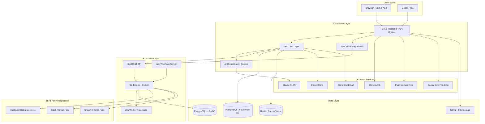
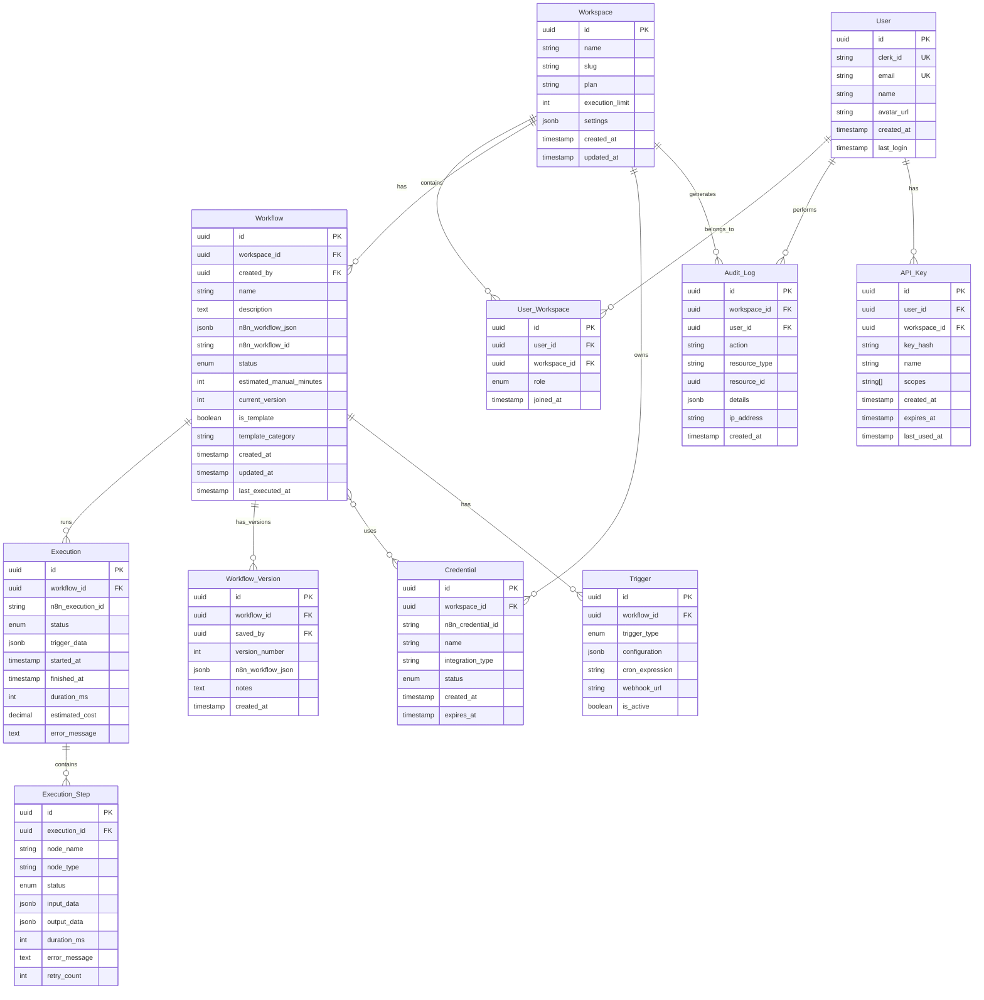

# FlowForge Live — Product Requirements Document

**Version:** 1.0  
**Date:** October 8, 2026  
**Author:** Signity Solutions  
**Status:** Draft for Review  
**Classification:** Confidential — For Internal Use  

---

## Table of Contents

1. [Executive Summary](#1-executive-summary)
2. [Problem Statement](#2-problem-statement)
3. [Target Users & Personas](#3-target-users--personas)
4. [Product Overview](#4-product-overview)
5. [Feature Specifications](#5-feature-specifications)
6. [Technical Architecture](#6-technical-architecture)
7. [n8n Integration Strategy](#7-n8n-integration-strategy)
8. [Data Model](#8-data-model)
9. [API Specification](#9-api-specification)
10. [Security & Compliance](#10-security--compliance)
11. [Pricing Strategy](#11-pricing-strategy)
12. [Competitive Analysis](#12-competitive-analysis)
13. [Success Metrics & KPIs](#13-success-metrics--kpis)
14. [Phased Roadmap](#14-phased-roadmap)
15. [Risks & Mitigations](#15-risks--mitigations)
16. [Appendices](#16-appendices)

---

## 1. Executive Summary

### 1.1 Vision

FlowForge Live is the AI-first workflow automation platform that builds itself. Where existing tools require users to manually wire together integrations step by step, FlowForge lets users describe what they want in plain English and instantly generates production-ready workflows powered by 1,500+ integrations.

### 1.2 Mission

To democratize workflow automation by combining the reliability of enterprise-grade execution infrastructure (n8n) with an intelligent, AI-powered frontend that makes automation accessible to every business professional — not just developers.

### 1.3 Tagline

**"The AI automation platform that builds itself."**

### 1.4 Market Opportunity

The global workflow automation market is valued at approximately $26 billion in 2026 and is projected to reach $40-50 billion by 2031-2032, growing at a CAGR of 9-13% depending on scope definition. Three tiers currently serve this market: no-code platforms (Zapier, Make.com), developer-centric tools (n8n, Temporal, Windmill), and enterprise iPaaS (MuleSoft, Workato, Tray.io).

FlowForge targets the underserved middle ground — teams that need more power than Zapier but less complexity than enterprise iPaaS. This segment represents approximately $8-12 billion of the total addressable market, growing faster than the overall market as mid-market companies accelerate digital transformation initiatives.

### 1.5 Key Differentiators vs. Zapier / Make / n8n Direct

FlowForge is the only platform combining three capabilities that competitors offer separately:

1. **Enterprise-grade execution engine** — 1,500+ connectors via embedded n8n, with built-in scheduling, retry logic, credential vault, and webhook infrastructure.
2. **AI-native workflow design** — Describe what you want in English, get a working workflow. Claude AI generates n8n workflow definitions from natural language descriptions, suggests optimizations, and explains complex workflows in plain English.
3. **Intelligent operations** — AI that monitors execution patterns, diagnoses failures, suggests auto-repairs, and answers natural language queries about your automation data ("How many leads came in this week?").

Additionally, FlowForge offers self-hosted deployment at 50-70% lower cost than Zapier at scale, white-label capability for agencies, and a visual builder that abstracts n8n's developer-oriented interface into a business-friendly experience.

### 1.6 Current State: POC Assessment

The FlowForge proof-of-concept is deployed at flowforge-app-production.up.railway.app. Built on Next.js with React and Tailwind CSS, it demonstrates the product vision with a polished UI including a landing page, sidebar navigation (6 sections), workflow gallery, execution streaming via Server-Sent Events, and dashboard with charts. However, the POC relies entirely on simulated data and mock API calls — no external services are actually connected, there is no database, no authentication, and no workflow builder/editor. The streaming execution engine and UI polish are the POC's strongest assets; the gap to production is primarily backend infrastructure.

---

## 2. Problem Statement

### 2.1 What Businesses Struggle With Today

Modern businesses rely on dozens of SaaS applications — CRMs, email platforms, payment processors, project management tools, analytics suites — yet these tools rarely communicate with each other natively. The result is a landscape of manual data entry, copy-paste workflows, and human-dependent handoffs that consume 20-30% of knowledge workers' time on repetitive tasks that could be automated.

According to industry research, 94% of workers perform repetitive, time-consuming tasks, yet fewer than 30% of mid-market businesses have adopted workflow automation beyond basic email sequences. The barrier is not awareness — it is complexity, cost, and the skills gap required to implement automation effectively.

### 2.2 Why Existing Tools Fall Short

**Zapier** democratized simple automation with its trigger-action model, but it becomes prohibitively expensive at scale ($600+/month for 10K tasks), lacks complex logic capabilities (limited branching, no loops until recently), and offers no AI assistance for workflow creation. Users hit a ceiling quickly when their needs grow beyond linear, two-step automations.

**Make.com** offers more power and better pricing ($16/month for 20K operations), but its visual interface has a steep learning curve. The scenario designer, while capable, requires understanding of data mapping, iterators, aggregators, and error routes that intimidate non-technical users. There is no AI layer to help users design or troubleshoot workflows.

**n8n** provides the most powerful open-source workflow engine with 1,500+ integrations, but it is squarely aimed at developers. Self-hosting requires DevOps expertise, the UI is code-centric, and there is no AI-assisted workflow creation. n8n Cloud (starting at EUR 20/month) simplifies hosting but retains the technical interface.

**Enterprise iPaaS** (MuleSoft, Workato, Tray.io) offers enterprise features but starts at $10K+/year, requires months of implementation, and is designed for IT departments rather than business teams.

### 2.3 The AI Gap in Workflow Automation

Despite the AI revolution transforming every software category, workflow automation remains stubbornly manual. Zapier introduced a basic AI feature, but it is limited to suggesting existing templates rather than generating custom workflows. No platform on the market today can take a natural language description like "When a new lead comes in HubSpot with a score above 80, enrich their company data with Apollo, check if they're in our target industries, send a personalized Slack notification to the assigned sales rep with the enriched data, and create a follow-up task in Asana due in 3 days" and produce a fully functional, production-ready workflow.

This is the gap FlowForge fills: combining the execution power of n8n with an AI layer that makes building, understanding, and operating workflows as natural as describing what you want in a conversation.

---

## 3. Target Users & Personas

### 3.1 Persona: SMB Operations Manager

**Name:** Sarah Chen  
**Title:** Director of Operations  
**Company:** 50-person SaaS company  
**Age:** 34  

**Background:** Sarah manages the operational backbone of a growing SaaS company. She coordinates processes across sales, marketing, customer success, and finance. She has used Zapier for basic automations but is frustrated by its pricing and limitations.

**Pain Points:**
- Spends 10+ hours/week on manual data synchronization between tools
- Zapier bill has grown to $400/month and keeps climbing
- Cannot build complex multi-step workflows without developer help
- No visibility into which automations are running, failing, or need attention
- Wants to automate onboarding, billing reconciliation, and reporting but lacks technical skills

**FlowForge Value:** Sarah describes her automation needs in plain English. FlowForge generates the workflows, monitors them, and alerts her when something needs attention — all at 50-70% less cost than her current Zapier bill.

**Key Quote:** "I know what I want automated, I just can't build it myself."

### 3.2 Persona: Marketing Team Lead

**Name:** Marcus Rivera  
**Title:** Head of Growth Marketing  
**Company:** B2B marketing agency with 15 employees  
**Age:** 29  

**Background:** Marcus runs multi-channel campaigns across HubSpot, Mailchimp, Google Ads, social media, and analytics platforms. He manages automations for lead scoring, email sequences, social posting, and campaign reporting.

**Pain Points:**
- Managing 50+ Zaps across client accounts is a nightmare
- No centralized view of automation health across campaigns
- Building complex lead scoring and routing workflows requires a developer
- Client deliverables (automated reports) require manual assembly
- Cannot offer white-label automation to agency clients

**FlowForge Value:** Marcus uses AI to quickly build client-specific automations, monitors them from a unified dashboard, and white-labels the platform for clients who want self-service automation.

**Key Quote:** "I need automations that are as sophisticated as my campaigns."

### 3.3 Persona: E-commerce Store Owner

**Name:** Priya Patel  
**Title:** Founder & CEO  
**Company:** D2C e-commerce brand, $2M revenue  
**Age:** 31  

**Background:** Priya runs a growing e-commerce brand on Shopify with integrations to Stripe, Klaviyo, ShipStation, and QuickBooks. She has no technical team and relies on apps and basic automations to keep operations running.

**Pain Points:**
- Order fulfillment, inventory alerts, and customer follow-ups are partially manual
- Abandoned cart recovery workflows break and she cannot diagnose why
- Syncing Shopify orders to QuickBooks for accounting requires manual CSV imports
- Reviews and customer feedback are not systematically collected or routed
- Cannot afford a developer for custom integrations

**FlowForge Value:** Priya selects from pre-built e-commerce templates, customizes them with natural language instructions, and lets FlowForge handle order routing, inventory management, and customer lifecycle automations. AI error diagnosis means she never needs to debug a broken workflow herself.

**Key Quote:** "I need my tools to just work together without me babysitting them."

### 3.4 Persona: SaaS Product Manager

**Name:** James Wu  
**Title:** Senior Product Manager  
**Company:** Series B SaaS startup, 200 employees  
**Age:** 36  

**Background:** James manages the product development lifecycle and needs to connect product analytics (Amplitude), customer feedback (Intercom), project management (Linear), and internal communications (Slack) into cohesive workflows.

**Pain Points:**
- Feature request tracking across Intercom, Slack, and Linear is manual
- Product usage alerts (churn signals) are not automated
- Sprint reporting requires pulling data from 4 different tools
- Beta user feedback loops are slow and inconsistent
- Wants to prototype internal tools but engineering bandwidth is limited

**FlowForge Value:** James builds automated product intelligence workflows — churn signal detection, feature request aggregation, sprint velocity reporting — using AI-generated workflows that connect his entire product stack.

**Key Quote:** "Every hour I spend gathering data is an hour I'm not building product."

### 3.5 Persona: Agency Owner

**Name:** Elena Kowalski  
**Title:** Managing Director  
**Company:** Digital services agency, 25 employees, 40+ clients  
**Age:** 42  

**Background:** Elena runs a digital agency that offers marketing, web development, and business process automation as services. She needs scalable, repeatable automation solutions she can deploy across clients.

**Pain Points:**
- Each client needs custom automation, but building from scratch is time-consuming
- No way to template and resell automation solutions
- Client onboarding for automation services takes 2-4 weeks
- White-labeling Zapier or Make is not possible
- Managing credentials across 40+ client accounts is a security concern

**FlowForge Value:** Elena uses FlowForge's white-label capability to offer branded automation to clients, leverages the template marketplace to rapidly deploy standard solutions, and uses AI to customize templates per client in minutes instead of days.

**Key Quote:** "I want to productize automation as a service."

### 3.6 Persona: Enterprise IT Admin

**Name:** David Okafor  
**Title:** IT Operations Manager  
**Company:** Enterprise, 2,000 employees  
**Age:** 45  

**Background:** David manages IT operations including system integrations, data flows, and compliance. He evaluates and deploys automation tools that meet enterprise security and governance requirements.

**Pain Points:**
- Shadow IT: business teams are using Zapier without IT oversight
- No audit trail or compliance controls on existing automations
- SSO/SAML integration is required for any new tool
- Data residency requirements mean cloud-only solutions are not viable
- Needs role-based access control for different departments

**FlowForge Value:** David deploys FlowForge self-hosted within the company's infrastructure, integrates SSO/SAML, enforces RBAC policies, and gains full audit logging. Business teams get the AI-powered simplicity they want while IT retains governance and control.

**Key Quote:** "I need to give teams automation freedom without losing governance."

---

## 4. Product Overview

### 4.1 Core Value Proposition

FlowForge Live is the first workflow automation platform where AI is not a feature — it is the foundation. Users interact with automation through natural language, visual building, and intelligent monitoring, while enterprise-grade infrastructure handles the execution invisibly.

The platform delivers three core promises:

1. **Build in minutes, not hours.** Describe a workflow in English and FlowForge generates it. Modify it visually or conversationally. No code required.
2. **Run with confidence.** 1,500+ battle-tested integrations powered by n8n, with built-in error handling, retry logic, and AI-powered error diagnosis.
3. **Scale without surprises.** Self-hosted option eliminates per-execution pricing. Pay for infrastructure, not usage. At 10K executions/month, FlowForge costs 50-70% less than Zapier.

### 4.2 Product Pillars

**Pillar 1: Visual Workflow Builder**  
A drag-and-drop canvas built with React Flow (xyflow) that translates visual workflow designs into n8n workflow definitions. Business users see friendly, categorized nodes (triggers, actions, conditions, loops, delays) while the system generates the underlying n8n JSON.

**Pillar 2: AI Engine**  
Claude AI powers three capabilities: (a) natural language to workflow generation, (b) error diagnosis and auto-repair suggestions, and (c) natural language querying of execution data. The AI layer is what differentiates FlowForge from every competitor.

**Pillar 3: Execution Layer**  
n8n runs as an embedded, self-hosted execution engine. It handles all workflow execution, scheduling, webhook reception, credential management, and integration connectivity. FlowForge's frontend never exposes n8n's UI — it communicates entirely through n8n's REST API.

**Pillar 4: Monitoring & Intelligence**  
Real-time execution streaming via Server-Sent Events, execution history with replay, performance analytics, cost tracking per workflow, and AI-prioritized notifications that suppress noise and escalate critical failures.

### 4.3 Platform Architecture (High-Level)

```
┌─────────────────────────────────────────────────────────┐
│                  FlowForge Frontend (Next.js)            │
│  Custom React UI | Workflow Builder | Dashboard | AI Chat│
├─────────────────────────────────────────────────────────┤
│                FlowForge API Layer (Next.js API Routes)  │
│  Auth (Clerk/Auth0) | SSE Streaming | Workflow CRUD      │
│  Analytics | tRPC                                        │
├─────────────────────────────────────────────────────────┤
│              n8n Execution Engine (Self-Hosted Docker)    │
│  1,500+ Connectors | Webhooks | Scheduling               │
│  Credential Vault | Retry Logic                          │
├─────────────────────────────────────────────────────────┤
│                    External Services                      │
│  Claude AI | HubSpot | Slack | Gmail | Shopify | etc.    │
└─────────────────────────────────────────────────────────┘
```

The architecture follows a layered approach where each layer has clear responsibilities:

- **Frontend Layer** handles all user interaction, rendering, and client-side state.
- **API Layer** mediates between the frontend and backend services, manages authentication, streams execution events, and orchestrates AI calls.
- **Execution Layer** (n8n) performs all actual workflow execution, manages credentials, and handles integrations.
- **External Services** are the third-party APIs and AI services that workflows connect to.

---

## 5. Feature Specifications

### 5.1 Visual Workflow Builder

**Description:**  
A drag-and-drop canvas built with React Flow (xyflow) that allows users to visually compose, edit, and configure workflows. The builder translates visual designs into n8n-compatible workflow JSON definitions. It provides a business-friendly abstraction over n8n's node system, grouping nodes by category and presenting configuration through guided forms rather than raw JSON.

**User Story:**  
*As an operations manager, I want to visually build a workflow by dragging triggers and actions onto a canvas, connecting them with edges, and configuring each step through a sidebar panel, so that I can create automations without writing code.*

**Acceptance Criteria:**

- Canvas supports drag-and-drop of nodes from a categorized palette
- Nodes can be connected via directional edges (output port to input port)
- Clicking a node opens a configuration panel in the sidebar
- Workflows can be saved, loaded, duplicated, and deleted
- Undo/redo support with keyboard shortcuts (Cmd+Z / Cmd+Shift+Z)
- Canvas supports zoom, pan, minimap, and auto-layout
- Workflow validation runs before save, highlighting errors (missing required fields, disconnected nodes, invalid configurations)
- Workflows save as n8n-compatible JSON definitions via the n8n REST API

**Wireframe Description:**  
The builder occupies the full viewport with a collapsible left sidebar showing the node palette organized by category (Triggers, Actions, Logic, Utilities). The main area is the React Flow canvas with a toolbar at the top for save, run, undo/redo, zoom controls, and an "AI Generate" button. Clicking a node on the canvas opens a right-side configuration panel with form fields specific to that node type. A bottom panel shows the execution log during test runs.

**Technical Notes:**

- Built with React Flow (xyflow) v12+ for the canvas
- Node palette uses a searchable, categorized list mapped from n8n's node type catalog
- Workflow JSON follows the n8n workflow definition schema
- Save operation calls `POST /api/v1/workflows` on the n8n REST API
- Real-time collaboration (Phase 4) via Yjs CRDT

**Node Types:**

| Category | Node Types |
|----------|------------|
| Triggers | Webhook, Schedule (Cron), Email Received, Form Submitted, App Event (HubSpot/Shopify/etc.) |
| Actions | Send Email, Send Slack Message, Create Record (CRM), Update Record, HTTP Request, Run Code |
| Logic | IF/Else Condition, Switch, Merge, Split, Loop, Wait/Delay |
| AI | Call Claude, Summarize Text, Extract Data, Classify, Generate Content |
| Utilities | Set Variable, Format Date, Parse JSON/CSV, Aggregate, Filter |

**Template Library (50+ Pre-Built Workflows):**  
Organized by category — Lead Management (12), E-commerce (10), Marketing (8), Customer Success (6), Finance & Ops (6), Developer & DevOps (5), HR & Recruiting (3). Each template includes a description, required integrations, estimated setup time, and one-click deploy.

**Version History:**  
Every save creates a version snapshot. Users can view a diff between versions, restore any previous version, and add version notes. Version history is stored in PostgreSQL with a JSONB column for the workflow definition.

### 5.2 AI Workflow Creation

**Description:**  
The AI engine allows users to describe a workflow in natural language and receive a fully functional n8n workflow definition. It also provides AI-suggested optimizations, error diagnosis with auto-fix suggestions, and workflow explanation in plain English.

**User Story:**  
*As a marketing lead, I want to describe a workflow in English — "When a new lead comes in HubSpot, enrich with Apollo, score based on company size and industry, and route to the appropriate sales rep in Slack" — and have FlowForge generate a complete, working workflow that I can review, tweak, and activate.*

**Acceptance Criteria:**

- Text input field (chat-style interface) accepts natural language workflow descriptions
- AI generates a valid n8n workflow JSON definition within 10 seconds
- Generated workflow appears on the visual canvas for review and editing
- AI explains each step of the generated workflow in plain English
- AI identifies potential issues or missing configurations (e.g., "You'll need to connect your HubSpot API key before activating this workflow")
- AI suggests optimizations for existing workflows (e.g., "You could add error handling here to retry failed API calls")
- AI can diagnose failed executions and suggest fixes based on error logs
- Conversation history is maintained so users can iteratively refine workflows

**Wireframe Description:**  
A chat panel slides in from the right side of the builder (similar to a copilot interface). Users type workflow descriptions in the chat input. The AI responds with a workflow preview (rendered on the canvas), an explanation of each step, and any required actions (connect credentials, configure settings). Users can reply to refine the workflow conversationally.

**Technical Notes:**

- AI calls use Claude API (Sonnet for speed, Opus for complex generation)
- Prompt engineering uses structured output with n8n workflow JSON schema
- Two-pass generation: (1) Generate workflow plan in structured format, (2) Convert plan to valid n8n JSON
- Template matching: AI first checks if a close template exists before generating from scratch
- Rate limiting: 50 AI generations per user per day (Pro), 200 (Team), unlimited (Enterprise)
- Streaming responses via SSE for real-time generation feedback

**AI Capabilities Matrix:**

| Capability | Input | Output | Model |
|-----------|-------|--------|-------|
| Workflow Generation | Natural language description | n8n workflow JSON + explanation | Claude Sonnet |
| Workflow Optimization | Existing workflow JSON + execution history | Optimization suggestions | Claude Sonnet |
| Error Diagnosis | Failed execution log + workflow JSON | Root cause + fix suggestions | Claude Sonnet |
| Auto-Fix | Error diagnosis result + user approval | Modified workflow JSON | Claude Sonnet |
| Workflow Explanation | n8n workflow JSON | Plain English step-by-step | Claude Haiku |
| NL Data Query | Natural language question + data context | SQL query + formatted answer | Claude Sonnet |

### 5.3 Integration Hub

**Description:**  
A centralized interface for managing all third-party service connections. The Integration Hub shows available integrations (1,500+ via n8n), their connection status, credential management, and usage across workflows.

**User Story:**  
*As a user, I want to browse available integrations by category, connect my accounts with OAuth or API keys, and see which workflows use each integration, so that I can manage my connected services in one place.*

**Acceptance Criteria:**

- Browse 1,500+ integrations organized by category (CRM, Email, Social, E-commerce, Payment, AI/ML, Database, Cloud Storage, Project Management, Communication, Analytics, Developer Tools)
- Search integrations by name or category
- Connect integrations via OAuth flow or API key entry
- View connection status (connected, disconnected, expired, error)
- See which workflows use each integration
- Test connection functionality
- Credential rotation and revocation
- Webhook URL generation and management per integration

**Integration Categories & Key Services:**

| Category | Key Integrations | Count |
|----------|-----------------|-------|
| CRM | HubSpot, Salesforce, Pipedrive, Zoho, Close | 40+ |
| Email | Gmail, Outlook, SendGrid, Mailchimp, Mailgun | 25+ |
| Social Media | Twitter/X, LinkedIn, Facebook, Instagram, Buffer | 20+ |
| E-commerce | Shopify, WooCommerce, Stripe, Square, BigCommerce | 35+ |
| Payment | Stripe, PayPal, Square, Braintree | 15+ |
| AI/ML | OpenAI, Claude, HuggingFace, Replicate, Pinecone | 20+ |
| Database | PostgreSQL, MySQL, MongoDB, Airtable, Supabase | 30+ |
| Cloud Storage | Google Drive, Dropbox, S3, OneDrive, Box | 15+ |
| Project Management | Asana, Jira, Linear, Monday, Notion, Trello | 25+ |
| Communication | Slack, Discord, Teams, Telegram, WhatsApp | 20+ |
| Analytics | Google Analytics, Mixpanel, Amplitude, Segment | 15+ |
| Developer Tools | GitHub, GitLab, Jenkins, Datadog, PagerDuty | 30+ |

**Custom API Connectors:**  
Users can create custom API connectors without code through a guided form: specify base URL, authentication method (API Key, OAuth2, Bearer Token, Basic Auth), request headers, and endpoint definitions. Custom connectors become available as nodes in the workflow builder.

**OAuth Management:**  
FlowForge handles the full OAuth flow — redirect, callback, token storage, and refresh. Tokens are encrypted at rest in n8n's credential vault. FlowForge proxies credential operations through its API layer, never exposing n8n's credential endpoints directly to the frontend.

**Webhook Receivers:**  
Each workflow can register webhook endpoints. FlowForge generates unique webhook URLs (e.g., `https://app.flowforge.io/webhook/{workflowId}/{webhookPath}`) and proxies incoming requests to the appropriate n8n workflow trigger. Webhook logs show recent deliveries, response codes, and payloads.

### 5.4 Execution & Monitoring

**Description:**  
Real-time visibility into every workflow execution with detailed step-by-step logs, error handling with configurable retry policies, rate limiting, execution replay, and per-workflow cost tracking.

**User Story:**  
*As an operations manager, I want to see real-time execution status of all my workflows, get alerted when something fails, and quickly diagnose and fix issues without needing developer help.*

**Acceptance Criteria:**

- Real-time execution status updates via Server-Sent Events (SSE)
- Step-by-step execution log showing input/output data for each node
- Execution status indicators: running (animated), success (green), failed (red), waiting (yellow)
- Error details with stack traces and AI-powered diagnosis
- Configurable retry policies per workflow: immediate retry, exponential backoff, fixed delay
- Rate limiting configuration per integration (e.g., max 100 HubSpot API calls per minute)
- Execution history with search, filter, and pagination
- Execution replay: re-run any historical execution with original or modified input data
- Cost tracking: estimated API costs per execution based on integration usage
- Bulk operations: pause, resume, or cancel multiple executions

**Technical Notes:**

- SSE connection from frontend to FlowForge API, which polls n8n execution status
- Execution history stored in PostgreSQL with JSONB for step-level data
- n8n provides execution data via its REST API (`GET /api/v1/executions`)
- Retry logic configured in the n8n workflow definition (error workflow nodes)
- Rate limiting implemented at the FlowForge API layer using Redis token bucket
- Cost estimation based on known API pricing (Zapier task equivalent calculation)

**Error Handling Tiers:**

| Tier | Behavior | Configuration |
|------|----------|--------------|
| Auto-retry | Retry immediately up to N times | Max retries: 1-10, delay: 0-60s |
| Backoff retry | Exponential backoff with jitter | Base: 1-60s, max: 5m-1h, factor: 2-4 |
| Failover | Execute alternate workflow on failure | Specify fallback workflow ID |
| Alert only | Send notification, do not retry | Email, Slack, webhook |
| AI diagnosis | Send error to Claude for analysis | Automatic on first failure |

### 5.5 Dashboard & Analytics

**Description:**  
A comprehensive dashboard showing workflow performance metrics, execution trends, success/failure rates, time and cost savings calculations, and usage patterns across the workspace.

**User Story:**  
*As a team lead, I want to see a dashboard that shows me how my automations are performing, how much time they're saving, and where I should invest in improving or building new workflows.*

**Acceptance Criteria:**

- Overview cards: total workflows (active/inactive), total executions (24h/7d/30d), success rate, estimated time saved
- Execution trend chart (line/area chart) showing executions over time with success/failure breakdown
- Top workflows by execution count, failure rate, and cost
- Integration usage breakdown (which integrations are used most)
- Time savings calculator: estimated hours saved based on average manual task time per workflow
- Cost savings calculator: comparison of FlowForge cost vs. Zapier equivalent cost
- Usage quota visualization (executions used / limit)
- Exportable reports (CSV, PDF)
- Real-time updates via polling (30-second refresh)

**Wireframe Description:**  
The dashboard is a grid layout with summary cards at the top (4 cards: Active Workflows, Executions Today, Success Rate, Hours Saved). Below is a large area chart showing execution trends over the selected time period (7d/30d/90d). The bottom section has two columns: left shows "Top Workflows" as a ranked list with sparklines, right shows "Integration Health" as a grid of connected service status indicators.

**Technical Notes:**

- Charts built with Recharts (already used in POC)
- Data aggregated from n8n execution history + FlowForge analytics tables
- Time savings: each workflow stores an estimated "manual minutes" value; multiply by execution count
- Cost comparison: FlowForge tracks actual infrastructure cost per execution vs. equivalent Zapier task pricing
- Dashboard data cached in Redis with 30-second TTL

### 5.6 Team & Permissions

**Description:**  
Multi-user workspaces with role-based access control, workflow approval workflows, and comprehensive audit logging for enterprise compliance requirements.

**User Story:**  
*As a team admin, I want to create a shared workspace where team members have different permission levels, certain workflows require approval before activation, and all changes are logged for audit purposes.*

**Acceptance Criteria:**

- Workspace creation with custom name, branding, and settings
- User invitation via email with role assignment
- Roles: Owner (full access), Admin (manage users + all workflows), Editor (create/edit workflows), Viewer (read-only access to workflows and analytics)
- Approval workflows: Editors can create workflows but require Admin/Owner approval to activate
- Shared credential pools: Admins manage integration credentials shared across the workspace
- Audit log: every action (create, edit, delete, activate, deactivate, execute) is logged with user, timestamp, IP address, and change details
- Workspace switching for users who belong to multiple workspaces
- Usage limits enforced per workspace based on subscription plan

**Permission Matrix:**

| Action | Owner | Admin | Editor | Viewer |
|--------|-------|-------|--------|--------|
| Manage workspace settings | Yes | Yes | No | No |
| Manage users & roles | Yes | Yes | No | No |
| Manage billing | Yes | No | No | No |
| Create/edit workflows | Yes | Yes | Yes | No |
| Activate workflows | Yes | Yes | With approval | No |
| Delete workflows | Yes | Yes | Own only | No |
| View execution logs | Yes | Yes | Yes | Yes |
| Manage credentials | Yes | Yes | No | No |
| View analytics | Yes | Yes | Yes | Yes |
| Export data | Yes | Yes | Yes | No |
| View audit log | Yes | Yes | No | No |

### 5.7 Scheduling & Triggers

**Description:**  
Comprehensive trigger system supporting cron-based scheduling, event-driven webhooks, email triggers, file change detection, manual triggers, and conditional trigger logic.

**User Story:**  
*As a user, I want to trigger my workflows on a schedule, when a specific event occurs in a connected app, or manually on demand, with the ability to add conditions that determine whether the workflow should actually run.*

**Acceptance Criteria:**

- Cron-based scheduling with visual cron builder (select minute, hour, day, weekday, month)
- Human-readable schedule descriptions ("Every weekday at 9:00 AM EST")
- Timezone support per workflow
- Event-driven triggers via webhooks (POST/GET with payload validation)
- App-specific triggers (e.g., "New contact in HubSpot," "New order in Shopify")
- Email triggers: workflows triggered by incoming emails to generated addresses
- File change triggers: watch a cloud storage folder (Google Drive, S3, Dropbox)
- Manual trigger: one-click execution from the UI with optional input parameters
- Conditional triggers: add filter conditions that must be met before the workflow runs (e.g., "Only run if the lead's country is US or CA")
- Trigger history: log of all trigger events with payloads and whether they resulted in execution
- Bulk scheduling: apply a schedule to multiple workflows at once

**Technical Notes:**

- n8n handles all trigger infrastructure natively (cron, webhook, app polling)
- FlowForge wraps n8n's trigger types in a user-friendly UI with preview and testing
- Conditional triggers are implemented as the first node in the n8n workflow (IF node after trigger)
- Email triggers use a generated address (e.g., `workflow-abc123@triggers.flowforge.io`) that routes to an n8n webhook
- File change triggers poll at configurable intervals (1 min to 1 hour)

---

## 6. Technical Architecture

### 6.1 System Architecture Diagram



### 6.2 Technology Stack

| Layer | Technology | Rationale |
|-------|-----------|-----------|
| Frontend | Next.js 15 + React 19 + Tailwind CSS | Already in use in POC; SSR for SEO, API routes for backend |
| Workflow Canvas | React Flow (xyflow) | Industry standard for visual node editors; used by n8n itself |
| Backend API | Next.js API Routes + tRPC | Type-safe API layer, real-time subscriptions for SSE |
| Execution Engine | n8n (self-hosted, Docker) | 1,500+ connectors, webhook infrastructure, scheduling, credential vault |
| AI Provider | Anthropic Claude API (Sonnet/Haiku) | Best-in-class for structured data extraction and reasoning |
| Database | PostgreSQL (Supabase or Neon) | Relational data for workflows, executions, users; n8n uses PG natively |
| Cache / Queue | Redis (Upstash) | Job queues, rate limiting, real-time pub/sub for execution events |
| Authentication | Clerk or Auth0 | Drop-in auth with SSO/SAML for enterprise tier |
| File Storage | S3 / Cloudflare R2 | Invoice PDFs, attachments, workflow exports |
| Monitoring | PostHog + Sentry | PostHog already integrated in POC; Sentry for error tracking |
| Hosting | Railway (app) + Hetzner (n8n) | Railway for the app; Hetzner for cost-effective n8n compute |
| CI/CD | GitHub Actions | Automated testing, deployment, n8n workflow sync |

### 6.3 Frontend Architecture

The frontend is a Next.js 15 application using the App Router with the following structure:

```
src/
├── app/
│   ├── (auth)/           # Login, signup, onboarding
│   ├── (dashboard)/      # Main app layout
│   │   ├── dashboard/    # Overview dashboard
│   │   ├── workflows/    # Workflow list + builder
│   │   ├── history/      # Execution history
│   │   ├── integrations/ # Integration hub
│   │   ├── analytics/    # Analytics & reports
│   │   ├── settings/     # Workspace settings
│   │   └── ai/           # AI chat interface
│   └── api/              # API routes (tRPC + REST)
├── components/
│   ├── builder/          # Workflow builder components
│   ├── dashboard/        # Dashboard widgets
│   ├── shared/           # Reusable UI components
│   └── ai/               # AI chat components
├── lib/
│   ├── n8n/              # n8n API client
│   ├── ai/               # Claude API integration
│   ├── db/               # Database queries (Drizzle ORM)
│   └── utils/            # Shared utilities
└── stores/               # Zustand state management
```

### 6.4 Backend Architecture

The backend uses Next.js API routes with tRPC for type-safe API communication. Key services:

- **Workflow Service:** CRUD operations on workflows, translating between FlowForge's visual representation and n8n workflow JSON. Handles versioning, duplication, and template management.
- **Execution Service:** Triggers workflow execution via n8n API, streams execution events via SSE, manages execution history, and handles retry logic.
- **AI Service:** Orchestrates calls to Claude API for workflow generation, error diagnosis, and natural language querying. Manages prompt templates, response parsing, and streaming.
- **Integration Service:** Manages credential lifecycle (create, test, rotate, revoke), proxies OAuth flows, and maintains integration catalog metadata.
- **Analytics Service:** Aggregates execution data for dashboard metrics, generates reports, and calculates time/cost savings.
- **Auth Service:** Integrates with Clerk/Auth0 for user authentication, manages workspace membership and RBAC.

### 6.5 Deployment Architecture

```
┌─────────────────────────────────────────────────┐
│              Production Environment              │
│                                                  │
│  ┌──────────────┐    ┌──────────────────────┐   │
│  │   Railway     │    │    Hetzner VPS       │   │
│  │   (Next.js)   │◄──►│    (n8n Docker)      │   │
│  │   Auto-scale  │    │    4 vCPU, 8GB RAM   │   │
│  └──────────────┘    └──────────────────────┘   │
│         │                      │                 │
│         ▼                      ▼                 │
│  ┌──────────────┐    ┌──────────────────────┐   │
│  │  Supabase PG  │    │  Supabase PG (n8n)   │   │
│  │  (FlowForge)  │    │  (Separate schema)   │   │
│  └──────────────┘    └──────────────────────┘   │
│         │                                        │
│         ▼                                        │
│  ┌──────────────┐    ┌──────────────────────┐   │
│  │   Upstash     │    │   Cloudflare R2      │   │
│  │   (Redis)     │    │   (File Storage)     │   │
│  └──────────────┘    └──────────────────────┘   │
└─────────────────────────────────────────────────┘
```

---

## 7. n8n Integration Strategy

### 7.1 Embedding Approach

n8n is deployed as a self-hosted Docker container running in API-only mode. The n8n web UI is never exposed to FlowForge users. All interaction with n8n occurs through its REST API, which FlowForge's backend calls server-side. This approach provides:

- **Complete UI control:** FlowForge presents its own branded, AI-enhanced interface
- **Security isolation:** n8n's admin endpoints are only accessible from the FlowForge backend (internal network only)
- **Upgrade flexibility:** n8n can be updated independently without affecting the frontend
- **White-label capability:** Clients never see or know about n8n

### 7.2 Workflow CRUD via n8n REST API

FlowForge translates between its visual builder representation and n8n's workflow JSON format:

**Create Workflow:**
```
POST {n8n_base_url}/api/v1/workflows
Headers: X-N8N-API-KEY: {api_key}
Body: { name, nodes, connections, settings, active }
```

**Read Workflow:**
```
GET {n8n_base_url}/api/v1/workflows/{id}
```

**Update Workflow:**
```
PATCH {n8n_base_url}/api/v1/workflows/{id}
Body: { nodes, connections, settings }
```

**Delete Workflow:**
```
DELETE {n8n_base_url}/api/v1/workflows/{id}
```

**Activate/Deactivate:**
```
PATCH {n8n_base_url}/api/v1/workflows/{id}
Body: { active: true/false }
```

### 7.3 Execution Monitoring via n8n API

FlowForge polls n8n's execution endpoints and transforms the data for its own UI:

```
GET {n8n_base_url}/api/v1/executions
Query: ?workflowId={id}&status=running&limit=50

GET {n8n_base_url}/api/v1/executions/{executionId}
```

For real-time streaming, FlowForge subscribes to n8n's execution events and relays them to the frontend via SSE. The FlowForge API layer maintains a Redis pub/sub channel per workspace for live execution updates.

### 7.4 Credential Management

Credentials are stored in n8n's built-in credential vault (encrypted at rest with AES-256-GCM). FlowForge manages credential lifecycle through its own API, proxying to n8n:

```
POST {n8n_base_url}/api/v1/credentials  # Create
GET {n8n_base_url}/api/v1/credentials   # List (metadata only, never raw values)
DELETE {n8n_base_url}/api/v1/credentials/{id}  # Revoke
```

FlowForge adds a layer of credential access control: credentials belong to a workspace, and only workspace members with Admin or Owner roles can manage them. Editors can use credentials in workflows but cannot view or modify the credential values.

### 7.5 Node Mapping (n8n Nodes to FlowForge Visual Nodes)

FlowForge maintains a mapping table that translates between n8n's node types and FlowForge's user-friendly node categories:

| FlowForge Category | FlowForge Node Name | n8n Node Type |
|--------------------|--------------------|---------------|
| Triggers | Webhook Received | n8n-nodes-base.webhook |
| Triggers | Schedule | n8n-nodes-base.scheduleTrigger |
| Triggers | New HubSpot Contact | n8n-nodes-base.hubspotTrigger |
| Actions | Send Slack Message | n8n-nodes-base.slack |
| Actions | Create HubSpot Deal | n8n-nodes-base.hubspot |
| Actions | Send Email (Gmail) | n8n-nodes-base.gmail |
| Logic | IF Condition | n8n-nodes-base.if |
| Logic | Switch | n8n-nodes-base.switch |
| Logic | Merge Data | n8n-nodes-base.merge |
| Logic | Loop Over Items | n8n-nodes-base.splitInBatches |
| Logic | Wait / Delay | n8n-nodes-base.wait |
| AI | Call Claude | @n8n/n8n-nodes-langchain.lmChatAnthropic |
| Utilities | Set Variable | n8n-nodes-base.set |
| Utilities | HTTP Request | n8n-nodes-base.httpRequest |
| Utilities | Code (JavaScript) | n8n-nodes-base.code |

Each mapping includes: display name, icon, description, configuration form schema (generated from n8n's node parameter definitions), and help documentation.

---

## 8. Data Model

### 8.1 Entity Relationship Overview



### 8.2 Key Design Decisions

- **Dual PostgreSQL:** FlowForge and n8n each use their own PostgreSQL database (or schemas). This keeps n8n's internal data model independent and simplifies n8n upgrades.
- **JSONB for workflow definitions:** Workflow JSON is stored as JSONB in both the FlowForge `workflows` table and the `workflow_versions` table, enabling efficient querying and diffing.
- **Credential abstraction:** FlowForge stores credential metadata (name, type, status) but the actual secrets live in n8n's encrypted credential vault. This avoids dual encryption and leverages n8n's battle-tested security.
- **Execution data split:** Summary execution data (status, timing, cost) lives in FlowForge's DB for fast dashboard queries. Detailed step-level data is stored in the `execution_steps` table and can also be fetched from n8n's API for the full payload.

---

## 9. API Specification

### 9.1 REST API Endpoints

FlowForge exposes a REST API for external integrations, CLI tools, and third-party developers.

**Base URL:** `https://api.flowforge.io/v1`

**Authentication:** Bearer token (API key) or OAuth2 access token.

#### Workflow Endpoints

| Method | Path | Description |
|--------|------|-------------|
| GET | /workflows | List all workflows in workspace |
| POST | /workflows | Create a new workflow |
| GET | /workflows/:id | Get workflow details |
| PATCH | /workflows/:id | Update workflow |
| DELETE | /workflows/:id | Delete workflow |
| POST | /workflows/:id/activate | Activate workflow |
| POST | /workflows/:id/deactivate | Deactivate workflow |
| POST | /workflows/:id/execute | Manually trigger execution |
| GET | /workflows/:id/versions | List version history |
| POST | /workflows/:id/versions/:v/restore | Restore a version |
| POST | /workflows/:id/duplicate | Duplicate workflow |

#### Execution Endpoints

| Method | Path | Description |
|--------|------|-------------|
| GET | /executions | List executions (filterable) |
| GET | /executions/:id | Get execution details with steps |
| POST | /executions/:id/retry | Retry a failed execution |
| POST | /executions/:id/cancel | Cancel a running execution |
| GET | /executions/:id/steps | Get step-level details |

#### Integration Endpoints

| Method | Path | Description |
|--------|------|-------------|
| GET | /integrations | List available integrations |
| GET | /integrations/connected | List connected integrations |
| POST | /integrations/:type/connect | Initiate connection (OAuth redirect) |
| DELETE | /integrations/:type/disconnect | Disconnect integration |
| POST | /integrations/:type/test | Test connection health |

#### AI Endpoints

| Method | Path | Description |
|--------|------|-------------|
| POST | /ai/generate | Generate workflow from NL description |
| POST | /ai/diagnose | Diagnose a failed execution |
| POST | /ai/optimize | Suggest optimizations for a workflow |
| POST | /ai/explain | Explain a workflow in plain English |
| POST | /ai/query | Natural language data query |

#### Webhook Endpoints

| Method | Path | Description |
|--------|------|-------------|
| POST | /webhooks/:workflowId/:path | Receive webhook (trigger workflow) |
| GET | /webhooks/:workflowId | List webhook configurations |
| POST | /webhooks/:workflowId | Register a new webhook |
| DELETE | /webhooks/:workflowId/:id | Remove a webhook |

### 9.2 Authentication

**API Keys:** Generated per workspace via the Settings page. Each key has configurable scopes (read, write, execute, admin) and optional expiration. Keys are hashed (bcrypt) before storage; the raw key is shown only once at creation.

**OAuth2:** For third-party integrations that need user-level access. Standard authorization code flow with PKCE. Scopes mirror API key scopes.

**Rate Limits:**

| Plan | Requests/minute | Concurrent connections |
|------|----------------|----------------------|
| Free | 60 | 2 |
| Pro | 300 | 10 |
| Team | 1,000 | 25 |
| Enterprise | 5,000+ | Custom |

### 9.3 Webhook API

Incoming webhooks follow a standardized format:

```
POST https://app.flowforge.io/webhook/{workflowId}/{path}
Content-Type: application/json

{
  "event": "order.created",
  "data": { ... },
  "timestamp": "2026-10-08T14:30:00Z"
}
```

Response:
```json
{
  "received": true,
  "executionId": "exec_abc123",
  "status": "queued"
}
```

Webhook endpoints support HMAC signature verification (X-FlowForge-Signature header), IP allowlisting, and payload size limits (5MB default, configurable up to 50MB).

---

## 10. Security & Compliance

### 10.1 Credential Encryption

All integration credentials (API keys, OAuth tokens, passwords) are encrypted at rest using AES-256-GCM within n8n's credential vault. The encryption key is stored as an environment variable, separate from the database. FlowForge never stores or transmits raw credential values — it references them by n8n credential ID.

Additional encryption measures:

- TLS 1.3 for all data in transit
- Database connections use SSL/TLS
- Redis connections use TLS (Upstash enforces this)
- File storage (R2/S3) uses server-side encryption

### 10.2 SOC 2 Readiness

FlowForge is designed with SOC 2 Type II certification in mind, implementing controls across the Trust Services Criteria:

- **Security:** Network segmentation, WAF (Cloudflare), DDoS protection, vulnerability scanning (Snyk), dependency auditing
- **Availability:** 99.9% uptime SLA, multi-region deployment option, automated failover, health monitoring (UptimeRobot)
- **Processing Integrity:** Input validation on all API endpoints, idempotent webhook processing, execution audit trail
- **Confidentiality:** Data classification (public, internal, confidential, restricted), encryption at rest and in transit, access logging
- **Privacy:** GDPR-compliant data handling, data retention policies, right to erasure implementation

### 10.3 GDPR Compliance

- **Data minimization:** FlowForge stores only the metadata necessary for workflow management. Execution payload data is retained for a configurable period (default: 30 days) and automatically purged.
- **Right to access:** Users can export all their data (workflows, execution history, credentials metadata, audit logs) via the Settings page.
- **Right to erasure:** Account deletion removes all user data, workflow definitions, execution history, and credentials. n8n credentials are deleted via API.
- **Data portability:** Workflows can be exported as JSON. Execution history can be exported as CSV.
- **Consent management:** Clear privacy policy, cookie consent, and opt-in analytics (PostHog respects Do Not Track).
- **Data Processing Agreement:** Available for Team and Enterprise plans.
- **Sub-processors:** Documented list of sub-processors (Supabase, Upstash, Railway, Hetzner, Cloudflare, Clerk/Auth0, Anthropic, PostHog, Sentry).

### 10.4 Data Isolation Per Workspace

- Each workspace's data is isolated at the application level using workspace_id foreign keys on all tables
- Row-level security (RLS) policies in PostgreSQL enforce workspace isolation at the database level
- n8n workflows are tagged with workspace metadata for logical isolation
- Enterprise tier: option for dedicated n8n instances per workspace for physical isolation
- API keys and OAuth tokens are scoped to a single workspace

### 10.5 Additional Security Measures

- **Input sanitization:** All user inputs are sanitized against XSS and SQL injection
- **Content Security Policy:** Strict CSP headers preventing inline script execution
- **CORS:** Restrictive CORS policy allowing only the FlowForge frontend origin
- **Rate limiting:** Per-user and per-IP rate limits on all API endpoints (Redis token bucket)
- **Webhook validation:** HMAC signature verification on incoming webhooks
- **Dependency scanning:** Automated Dependabot + Snyk scanning on all dependencies
- **Penetration testing:** Annual third-party penetration testing (planned for post-MVP)

---

## 11. Pricing Strategy

### 11.1 Pricing Tiers

| Feature | Free / Hobby | Pro | Team | Enterprise | Self-Hosted |
|---------|-------------|-----|------|------------|-------------|
| **Price** | $0/mo | $49/mo | $149/mo | Custom | $299/mo (license) |
| **Executions/month** | 100 | 5,000 | 25,000 | Unlimited | Unlimited |
| **Workflows** | 3 | Unlimited | Unlimited | Unlimited | Unlimited |
| **Users** | 1 | 1 | 5 | Unlimited | Unlimited |
| **AI generations/day** | 5 | 50 | 200 | Unlimited | Unlimited |
| **Integrations** | 10 | All 1,500+ | All 1,500+ | All 1,500+ | All 1,500+ |
| **Execution history** | 7 days | 30 days | 90 days | 365 days | Unlimited |
| **Support** | Community | Email | Priority email | Dedicated + SLA | Email |
| **AI builder** | Basic | Full | Full | Full + custom | Full |
| **Custom connectors** | No | 3 | 10 | Unlimited | Unlimited |
| **SSO/SAML** | No | No | No | Yes | Yes |
| **White-label** | No | No | No | Yes | Yes |
| **Audit log** | No | No | Yes | Yes | Yes |
| **Dedicated infra** | No | No | No | Optional | Self-managed |

### 11.2 Pricing Rationale

The pricing is designed to be significantly cheaper than Zapier at every tier while offering more features:

| Usage Level | FlowForge | Zapier | Make.com | n8n Cloud | Savings vs. Zapier |
|-------------|-----------|--------|----------|-----------|-------------------|
| 100 exec/mo | $0 | $0 (Free) | $0 (Free) | $0 (Free) | — |
| 1,000 exec/mo | $49 | $49.99 | $9 | €20 | ~0% (but more features) |
| 5,000 exec/mo | $49 | $149+ | $16 | €20 | 67% |
| 10,000 exec/mo | $149 | $299+ | $29 | €50 | 50% |
| 25,000 exec/mo | $149 | $599+ | $63 | €50 | 75% |
| 100,000 exec/mo | Custom | $1,200+ | $237 | Custom | 50-70% |

FlowForge's pricing advantage comes from its self-hosted n8n architecture — the marginal cost of an additional execution is near-zero (server compute only), unlike Zapier/Make where each operation is a billable unit.

### 11.3 Revenue Model

- **SaaS subscriptions:** Primary revenue driver. Target $3,500 MRR by Month 6.
- **Overage charges:** $0.005 per execution beyond plan limits (automatic, no surprise bills — executions are throttled, not cut off, with a warning).
- **Self-hosted licenses:** $299/month for organizations that want to run FlowForge on their own infrastructure.
- **Enterprise contracts:** Custom annual contracts starting at $1,000/month for large organizations.
- **Template marketplace:** Future revenue from premium templates (30% commission, Phase 3+).

---

## 12. Competitive Analysis

### 12.1 Competitive Landscape

The workflow automation market in 2026 consists of four distinct tiers, each serving different segments:

**Tier 1 — No-Code Platforms (Consumer/SMB):** Zapier, Make.com, IFTTT. Simple trigger-action model, broad integrations, limited complexity.

**Tier 2 — Pro/Developer Platforms:** n8n, Activepieces, Windmill. More powerful, often open-source, steeper learning curve.

**Tier 3 — Enterprise iPaaS:** MuleSoft, Workato, Tray.io, Boomi. Full enterprise features, $10K+/year, months of implementation.

**Tier 4 — AI-Native (Emerging):** FlowForge, and a few early-stage startups. AI-first approach to workflow creation and management.

FlowForge positions itself between Tier 1 and Tier 2 — the ease of use of Zapier with the power of n8n and the intelligence of AI.

### 12.2 Feature Comparison Matrix

| Capability | FlowForge | Zapier | Make.com | n8n | Activepieces | Windmill |
|-----------|-----------|--------|----------|-----|--------------|----------|
| AI-powered workflow generation | **Yes** | Limited | No | No | No | No |
| AI step execution (Claude) | **Yes** | No | No | Plugin only | No | No |
| Natural language operations | **Yes** | No | No | No | No | No |
| Self-hosted option | **Yes** | No | No | Yes | Yes | Yes |
| Visual workflow builder | **Yes** | Yes | Yes | Yes | Yes | Yes |
| Pre-built connectors | 1,500+ (via n8n) | 7,000+ | 2,000+ | 1,500+ | 350+ | 200+ |
| Custom code support | **Yes** | Limited | Yes | Yes | Yes | Yes |
| White-label ready | **Yes** | No | No | Enterprise | Yes | No |
| Real-time streaming | **Yes** | No | No | Yes | No | Yes |
| Error auto-diagnosis | **Yes (AI)** | No | No | No | No | No |
| Template marketplace | **Yes** | Yes | Yes | Yes | Yes | No |
| Cost at 10K exec/mo | **$149** | $299+ | $29 | €50 (cloud) | ~$50 | Free (self-hosted) |
| Credential vault | **Yes** | Yes | Yes | Yes | Yes | Yes |
| Webhook support | **Yes** | Yes | Yes | Yes | Yes | Yes |
| Multi-user / RBAC | **Yes** | Team plan | Team plan | Enterprise | Yes | Yes |
| API access | **Yes** | Yes | Yes | Yes | Yes | Yes |
| SOC 2 ready | **Planned** | Yes | Yes | Enterprise | No | No |

### 12.3 Positioning Strategy

FlowForge does not compete directly with any single incumbent. Instead, it occupies a unique position:

- **vs. Zapier:** "All the ease, fraction of the cost, and AI that actually builds your workflows."
- **vs. Make.com:** "Comparable pricing, but you don't need to learn scenarios — just describe what you want."
- **vs. n8n:** "The same 1,500+ integrations, wrapped in an interface your whole team can use, with AI that writes the workflows for you."
- **vs. Activepieces:** "More integrations, more AI, enterprise-ready from day one."
- **vs. Enterprise iPaaS:** "90% of the capability at 10% of the cost, deployed in hours not months."

The core positioning narrative: **"The AI automation platform that builds itself."** This captures the unique value — AI-native workflow creation — in a memorable way that differentiates from every competitor.

---

## 13. Success Metrics & KPIs

### 13.1 North Star Metric

**Weekly Active Workflows (WAW):** The number of workflows that successfully executed at least once in the past 7 days. This metric captures both user adoption (creating workflows) and product quality (workflows running successfully).

### 13.2 User Acquisition Metrics

| Metric | Month 3 Target | Month 6 Target | Measurement |
|--------|---------------|----------------|-------------|
| Registered Users | 200 | 1,000 | Auth provider dashboard |
| Monthly Active Users (MAU) | 50 | 300 | PostHog |
| Signup → Active Workflow (Activation) | 30% | 40% | Internal analytics |
| Organic Signups (% of total) | 40% | 60% | Attribution tracking |
| Cost per Acquisition (CPA) | <$50 | <$30 | Ad spend / signups |

### 13.3 Engagement Metrics

| Metric | Month 3 Target | Month 6 Target | Measurement |
|--------|---------------|----------------|-------------|
| Workflows per Active User | 2.5 | 4.0 | Internal analytics |
| AI-Generated Workflows (% of total) | 40% | 60% | Internal analytics |
| Weekly Active Workflows (WAW) | 80 | 500 | Internal analytics |
| Session Duration (avg) | 8 min | 12 min | PostHog |
| DAU/MAU Ratio | 25% | 35% | PostHog |

### 13.4 Workflow & Execution Metrics

| Metric | Month 3 Target | Month 6 Target | Measurement |
|--------|---------------|----------------|-------------|
| Total Workflows Created | 500 | 4,000 | Internal analytics |
| Workflow Execution Success Rate | >95% | >98% | Internal analytics |
| Total Workflow Executions (monthly) | 10,000 | 100,000 | Internal analytics |
| Avg. Execution Time | <30s | <15s | Internal analytics |
| AI Generation Success Rate | >80% | >90% | Internal analytics |

### 13.5 Revenue Metrics

| Metric | Month 3 Target | Month 6 Target | Measurement |
|--------|---------------|----------------|-------------|
| Paying Customers | 10 | 50 | Stripe |
| Monthly Recurring Revenue (MRR) | $500 | $3,500 | Stripe |
| Average Revenue per User (ARPU) | $50 | $70 | Stripe |
| Free → Paid Conversion | 5% | 8% | Internal analytics |
| Churn Rate (monthly) | <8% | <5% | Stripe |
| Net Revenue Retention | >100% | >110% | Stripe |

### 13.6 Operational Metrics

| Metric | Target | Measurement |
|--------|--------|-------------|
| Platform Uptime | 99.9% | UptimeRobot |
| API Response Time (p95) | <500ms | Sentry |
| n8n Engine Availability | 99.95% | Health checks |
| Mean Time to Recovery (MTTR) | <30 min | Incident tracking |
| NPS Score | >40 (Month 3), >50 (Month 6) | In-app survey |

---

## 14. Phased Roadmap

### Phase 1: Foundation (Weeks 1-4) — MVP Infrastructure

**Goal:** Replace simulated POC backend with real infrastructure. Users can run the 5 existing workflows with live data flowing through actual integrations.

**Deliverables:**

| Deliverable | Description | Priority | Effort |
|-------------|-------------|----------|--------|
| n8n self-hosted deployment | Docker Compose on Hetzner VPS with persistent volume | P0 | 1 week |
| n8n REST API integration | Create, read, execute workflows via n8n API from FlowForge backend | P0 | 2 weeks |
| PostgreSQL schema + migrations | Persist workflow definitions, execution history, user settings | P0 | 1 week |
| Authentication (Clerk) | User login, session management, API key generation | P0 | 1.5 weeks |
| Real Claude AI integration | Replace canned responses with actual Anthropic API calls | P0 | 1.5 weeks |
| 5 live workflow templates | Convert existing 5 POC workflows to real n8n workflow definitions | P0 | 2 weeks |
| Credential management UI | Allow users to add their own HubSpot, Slack, Gmail API keys | P1 | 2 weeks |
| Real SSE execution streaming | Connect SSE stream to actual n8n execution events | P1 | 1.5 weeks |

**Milestone:** 5 production workflows executing against real APIs with real-time streaming.

### Phase 2: Workflow Builder + AI Generation (Weeks 5-8)

**Goal:** Enable users to create custom workflows with a visual drag-and-drop builder. AI-assisted builder generates n8n workflows from natural language descriptions.

**Deliverables:**

| Deliverable | Description | Priority | Effort |
|-------------|-------------|----------|--------|
| Visual workflow builder | Drag-and-drop canvas (React Flow) for composing workflow steps | P0 | 4 weeks |
| AI workflow generation | Describe a workflow in English, Claude generates n8n JSON definition | P0 | 3 weeks |
| Step configuration panels | Configure each step's parameters, mapping, conditions | P0 | 2.5 weeks |
| Workflow testing sandbox | Test workflows with sample data before activating | P1 | 2 weeks |
| Template marketplace | Browse and fork community/pre-built workflow templates | P1 | 2 weeks |
| Version history | Track changes to workflows with rollback capability | P2 | 1.5 weeks |
| Conditional branching UI | Visual if/else, switch, and router step configuration | P1 | 2 weeks |

**Milestone:** Users create custom workflows visually or via AI, test them, and activate them.

### Phase 3: Intelligence Layer (Weeks 9-12)

**Goal:** Add the AI capabilities that differentiate FlowForge from vanilla n8n — intelligent monitoring, auto-healing, and natural language operations.

**Deliverables:**

| Deliverable | Description | Priority | Effort |
|-------------|-------------|----------|--------|
| AI error diagnosis | Claude analyzes failed runs and suggests fixes or auto-repairs | P0 | 2 weeks |
| Natural language querying | Ask "How many leads came in this week?" in plain English | P0 | 2 weeks |
| Smart notifications | AI-prioritized alerts — suppress noise, escalate important failures | P1 | 1.5 weeks |
| Workflow optimization suggestions | Claude analyzes execution patterns and suggests improvements | P1 | 2 weeks |
| Advanced analytics dashboard | Real charts from real data: trends, bottlenecks, cost tracking | P0 | 2 weeks |
| Webhook management | Register, test, and monitor incoming webhooks per workflow | P1 | 1.5 weeks |
| Audit logging | Complete trail of who changed what and when | P1 | 1.5 weeks |

**Milestone:** Self-healing workflows, NL data queries, production-grade monitoring.

### Phase 4: Scale & Enterprise (Weeks 13-20)

**Goal:** Enterprise features, multi-tenancy, and scaling for production workloads.

**Deliverables:**

| Deliverable | Description | Priority | Effort |
|-------------|-------------|----------|--------|
| Multi-tenancy | Isolated workspaces per organization with RBAC | P0 | 3 weeks |
| SSO/SAML integration | Enterprise single sign-on (via n8n Enterprise or custom) | P0 | 1.5 weeks |
| Team collaboration | Shared workflows, comments, approval flows | P1 | 2 weeks |
| Custom connector builder | UI for building custom API integrations without code | P1 | 2.5 weeks |
| White-label deployment | Rebrandable for agencies and resellers | P2 | 2 weeks |
| Horizontal scaling | Kubernetes deployment with worker queue architecture | P1 | 2 weeks |
| SLA monitoring | Track and guarantee uptime, execution latency, data processing SLAs | P2 | 1.5 weeks |
| SOC 2 compliance prep | Security controls, data handling policies, penetration testing | P1 | 2 weeks |

**Milestone:** Enterprise-ready product with SSO, multi-tenancy, RBAC, and audit logging.

### Roadmap Timeline Visualization

```
Week:  1    2    3    4    5    6    7    8    9   10   11   12   13   14   15   16   17   18   19   20
       ├────────────────────┤
       │  Phase 1: Foundation │
       │  n8n + DB + Auth    │
       │  5 live workflows   │
       │                     │
                              ├────────────────────┤
                              │  Phase 2: Builder    │
                              │  Visual builder      │
                              │  AI generation       │
                              │                      │
                                                      ├────────────────────┤
                                                      │  Phase 3: Intel     │
                                                      │  AI diagnosis       │
                                                      │  NL queries         │
                                                      │                     │
                                                                             ├───────────────────────────────┤
                                                                             │  Phase 4: Enterprise           │
                                                                             │  Multi-tenant + SSO + Scale    │
                                                                             │                                │
```

---

## 15. Risks & Mitigations

### 15.1 Technical Risks

| Risk | Probability | Impact | Mitigation |
|------|------------|--------|------------|
| **n8n API breaking changes** — n8n updates its REST API, breaking FlowForge's integration | Medium | High | Pin n8n version; maintain abstraction layer between FlowForge and n8n API; automated integration tests on each n8n update; contribute to n8n API stability discussions |
| **n8n license changes** — n8n changes its fair-use license to be more restrictive | Low | Critical | FlowForge uses n8n Community Edition under the Sustainable Use License; maintain the ability to fork if license changes; the abstraction layer allows swapping execution engines |
| **AI generation quality** — Claude generates invalid or suboptimal workflow definitions | High | Medium | Two-pass validation (generate → validate → fix); maintain a library of tested workflow patterns; human review step before activation; continuous prompt improvement based on failure logs |
| **Scaling bottleneck** — Single n8n instance cannot handle execution volume | Medium | High | Start with vertical scaling (bigger VPS); Phase 4 adds horizontal scaling with n8n worker mode + Redis queue; load testing at 1K, 10K, 100K executions/day |
| **Real-time streaming reliability** — SSE connections drop or lag under load | Medium | Medium | Implement reconnection with exponential backoff; fall back to polling if SSE fails; Redis pub/sub as the streaming backbone |

### 15.2 Business Risks

| Risk | Probability | Impact | Mitigation |
|------|------------|--------|------------|
| **Competitor launches AI features** — Zapier or Make ship AI workflow generation | High | High | FlowForge's AI is the core product, not an add-on; deeper AI integration (error diagnosis, NL queries, optimization) creates a moat; speed to market matters |
| **Slow user acquisition** — Users don't discover or adopt FlowForge | Medium | High | Content marketing (SEO for "AI workflow automation"), Product Hunt launch, n8n community outreach, free tier for viral growth, case studies showing ROI |
| **Pricing pressure** — Make.com and Activepieces undercut on price | Medium | Medium | FlowForge's self-hosted architecture means marginal cost is near-zero; compete on AI value, not price; the self-hosted tier offers unlimited executions |
| **Churn from complexity** — Users find the platform too complex for simple automations | Medium | Medium | Onboarding wizard, template library, AI generation reduces complexity; focus user testing on non-technical personas; progressive complexity (simple → advanced) |

### 15.3 Operational Risks

| Risk | Probability | Impact | Mitigation |
|------|------------|--------|------------|
| **Security breach** — Credential leak or unauthorized access | Low | Critical | Encryption at rest (AES-256), TLS in transit, regular security audits, penetration testing, SOC 2 compliance roadmap, bug bounty program (Phase 4) |
| **Data loss** — Database corruption or deletion | Low | Critical | Daily automated backups (Supabase), point-in-time recovery, separate backup for n8n data, disaster recovery runbook |
| **Team bandwidth** — Engineering team too small for ambitious roadmap | Medium | High | Prioritize ruthlessly (P0 only in each phase); hire contractor for specialized work (DevOps, security); leverage n8n's existing infrastructure to reduce build scope |
| **Third-party API changes** — HubSpot, Slack, etc. change their APIs | Medium | Low | n8n community maintains connectors; FlowForge benefits from n8n's 800+ contributors keeping connectors updated |

---

## 16. Appendices

### Appendix A: Glossary

| Term | Definition |
|------|-----------|
| **Workflow** | A sequence of automated steps that execute in response to a trigger event |
| **Execution** | A single run of a workflow from trigger to completion |
| **Node** | An individual step in a workflow (trigger, action, condition, etc.) |
| **Edge** | A connection between two nodes that defines the flow of data |
| **Trigger** | The event that starts a workflow (webhook, schedule, app event, manual) |
| **Action** | A step that performs an operation (send email, create record, HTTP request) |
| **Condition** | A branching step that routes execution based on data values |
| **Connector** | An integration with a third-party service (HubSpot connector, Slack connector) |
| **Credential** | The authentication data (API key, OAuth token) for a connected service |
| **Workspace** | An isolated environment containing workflows, credentials, and team members |
| **n8n** | The open-source workflow automation engine that powers FlowForge's execution layer |
| **SSE** | Server-Sent Events — a protocol for streaming real-time updates from server to client |
| **RBAC** | Role-Based Access Control — permission management based on user roles |
| **iPaaS** | Integration Platform as a Service — enterprise integration solutions |

### Appendix B: User Flow Diagrams

**B.1 — New User Onboarding Flow**

```
Landing Page → Sign Up (Clerk) → Welcome Screen → Choose Use Case
    → [Marketing] → Suggest marketing templates → Connect HubSpot/Mailchimp
    → [E-commerce] → Suggest e-commerce templates → Connect Shopify/Stripe
    → [Operations] → Suggest ops templates → Connect Slack/Gmail
    → [Custom] → Open AI chat → Describe your first workflow

→ Activate First Workflow → Dashboard (confetti celebration)
→ Prompt to connect additional integrations
```

**B.2 — AI Workflow Creation Flow**

```
Open AI Chat → Describe workflow in English
→ AI generates workflow plan (streaming)
→ Workflow appears on visual canvas
→ AI explains each step
→ AI flags missing credentials → User connects credentials
→ User reviews and optionally edits nodes
→ User clicks "Test" → Sandbox execution with sample data
→ Review test results → Fix issues (AI-assisted)
→ User clicks "Activate" → Workflow is live
→ Redirect to execution monitoring
```

**B.3 — Error Recovery Flow**

```
Workflow execution fails → Error logged
→ AI error diagnosis runs automatically
→ Notification sent (email/Slack) with diagnosis summary
→ User opens execution detail → Sees step-by-step log
→ Failed step highlighted in red with error message
→ AI diagnosis panel shows:
    - Root cause explanation
    - Suggested fix (code/config change)
    - "Apply Fix" button (creates new workflow version)
→ User applies fix → Re-test → Success → Activate updated version
```

### Appendix C: Sample Workflow JSON (n8n Format)

**Lead Enrichment & Routing Workflow:**

```json
{
  "name": "Lead Enrichment & Slack Routing",
  "nodes": [
    {
      "parameters": {
        "events": ["contact.creation"]
      },
      "name": "HubSpot Trigger",
      "type": "n8n-nodes-base.hubspotTrigger",
      "position": [250, 300]
    },
    {
      "parameters": {
        "resource": "person",
        "operation": "enrich",
        "email": "={{$json.properties.email}}"
      },
      "name": "Enrich with Apollo",
      "type": "n8n-nodes-base.apolloIo",
      "position": [450, 300]
    },
    {
      "parameters": {
        "conditions": {
          "number": [{
            "value1": "={{$json.company.employees}}",
            "operation": "largerEqual",
            "value2": 50
          }]
        }
      },
      "name": "Check Company Size",
      "type": "n8n-nodes-base.if",
      "position": [650, 300]
    },
    {
      "parameters": {
        "channel": "#enterprise-leads",
        "text": "New enterprise lead: {{$node['HubSpot Trigger'].json.properties.firstname}} {{$node['HubSpot Trigger'].json.properties.lastname}} from {{$node['Enrich with Apollo'].json.company.name}} ({{$node['Enrich with Apollo'].json.company.employees}} employees)",
        "attachments": []
      },
      "name": "Notify Enterprise Team",
      "type": "n8n-nodes-base.slack",
      "position": [850, 200]
    },
    {
      "parameters": {
        "channel": "#smb-leads",
        "text": "New SMB lead: {{$node['HubSpot Trigger'].json.properties.firstname}} {{$node['HubSpot Trigger'].json.properties.lastname}}",
        "attachments": []
      },
      "name": "Notify SMB Team",
      "type": "n8n-nodes-base.slack",
      "position": [850, 400]
    }
  ],
  "connections": {
    "HubSpot Trigger": {
      "main": [
        [{ "node": "Enrich with Apollo", "type": "main", "index": 0 }]
      ]
    },
    "Enrich with Apollo": {
      "main": [
        [{ "node": "Check Company Size", "type": "main", "index": 0 }]
      ]
    },
    "Check Company Size": {
      "main": [
        [{ "node": "Notify Enterprise Team", "type": "main", "index": 0 }],
        [{ "node": "Notify SMB Team", "type": "main", "index": 0 }]
      ]
    }
  },
  "settings": {
    "executionOrder": "v1"
  }
}
```

### Appendix D: Template Library (Launch Categories)

| Category | Template Name | Integrations | Description |
|----------|--------------|-------------|-------------|
| Lead Mgmt | Lead Enrichment & Routing | HubSpot, Apollo, Slack | Enrich new leads and route by company size |
| Lead Mgmt | Lead Scoring Automation | HubSpot, Claude AI | AI-powered lead scoring based on profile data |
| Lead Mgmt | CRM Data Sync | HubSpot, Salesforce | Bidirectional contact sync between CRMs |
| E-commerce | Order Fulfillment Notify | Shopify, Slack, Email | Notify team on new orders, send customer confirmation |
| E-commerce | Abandoned Cart Recovery | Shopify, Klaviyo | Trigger email sequence for abandoned carts |
| E-commerce | Inventory Alert | Shopify, Slack | Alert when product stock falls below threshold |
| Marketing | Social Media Scheduler | Buffer, Google Sheets | Publish social posts from a content calendar |
| Marketing | Blog Post Distribution | WordPress, Twitter, LinkedIn | Auto-share new blog posts across channels |
| Marketing | Campaign Reporting | Google Ads, GA4, Slack | Weekly campaign performance summary |
| Cust. Success | NPS Follow-up | Typeform, Slack, HubSpot | Route NPS responses and trigger follow-up |
| Cust. Success | Churn Risk Alert | Stripe, HubSpot, Slack | Alert when customer payment fails or downgrades |
| Finance | Invoice Processing | Gmail, QuickBooks, Slack | Extract invoice data from email and log to accounting |
| Finance | Expense Report | Google Sheets, Slack | Weekly expense summary from shared sheet |
| DevOps | Deploy Notification | GitHub, Slack | Notify team on successful deployments |
| DevOps | Error Alert Routing | Sentry, PagerDuty, Slack | Route errors to on-call engineer |
| HR | New Employee Onboarding | Gmail, Slack, Notion | Welcome email, Slack invite, provision docs |

### Appendix E: Infrastructure Cost Projections

**Baseline (0-1,000 users, <100K executions/month):**

| Service | Tier | Monthly Cost |
|---------|------|-------------|
| Railway (Next.js app) | Pro | $20-50 |
| Hetzner VPS (n8n) | CPX31 (4 vCPU, 8GB) | $15-30 |
| PostgreSQL (Supabase) | Pro | $25 |
| Redis (Upstash) | Pay-as-you-go | $0-10 |
| Cloudflare R2 | Standard | $0-5 |
| Clerk (Auth) | Pro | $25 |
| PostHog (Analytics) | Free tier | $0 |
| Sentry (Errors) | Team | $26 |
| Domain + DNS | Cloudflare | $15/yr |
| **SUBTOTAL (Infrastructure)** | | **$111-171/mo** |

**Variable (API Usage at 1K workflow executions/month):**

| Service | Unit | Cost per Unit | Est. Monthly |
|---------|------|--------------|-------------|
| Claude API (Sonnet) | 1M input tokens | $3.00 | $30-90 |
| Claude API (Haiku) | 1M input tokens | $0.25 | $5-15 |
| SendGrid (Email) | Email | $0.001 | $5-10 |
| **SUBTOTAL (Variable)** | | | **$40-115/mo** |

**Total Monthly Operating Cost:** $151-286/month at baseline. At 10,000 executions/month: $500-1,200/month. At 100,000 executions/month: $2,000-5,000/month (with Hetzner scaling to dedicated servers).

---

*This document is confidential and intended for internal use by Signity Solutions. For questions or to begin development, contact amit@signitysolutions.com.*

**Document Version History:**

| Version | Date | Author | Changes |
|---------|------|--------|---------|
| 1.0 | October 8, 2026 | Signity Solutions | Initial comprehensive PRD |
