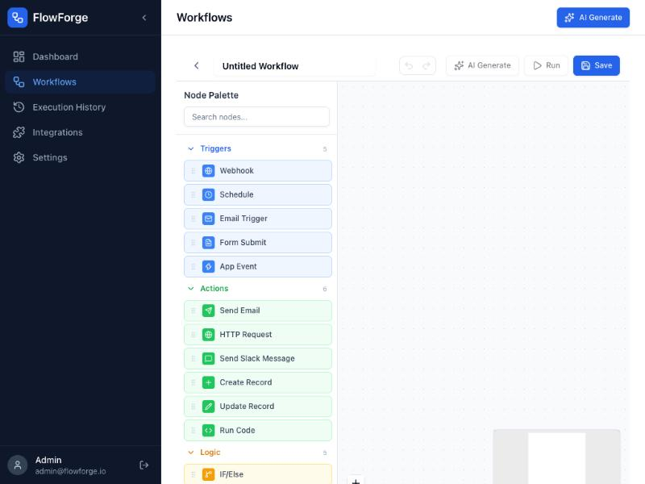

# FlowForge Live

## Overview

FlowForge Live is a visual workflow automation app. A workflow is a graph of connected steps (a trigger, actions, and decisions). You run it against editable sample data and inspect each step's input, mapped output, branch taken, and any failure and recovery.

It ships with eight ready-to-run workflows for agencies, ecommerce, and service businesses, and has two modes:

| Mode | Description | Requires |
| --- | --- | --- |
| **Demo** (default) | Self-contained workspace. A deterministic engine runs workflows in the browser against virtual providers; state lives in `localStorage`. | Nothing |
| **Legacy** | Database-backed version with sign-in, REST API routes, PostgreSQL persistence, and optional AI workflow generation. | PostgreSQL, `NEXTAUTH_SECRET`, and a build with `NEXT_PUBLIC_DEMO_MODE=false` |

> **Nothing here talks to real services.** Neither mode sends emails, writes to a CRM, takes payments, or calls third-party business APIs. Slack, Gmail, HubSpot, and the other providers are simulated. See [Implemented vs. simulated](#implemented-vs-simulated).



<sub>Legacy-mode interface with sample data. More screenshots are in [`screenshots/`](screenshots/).</sub>

## Features

### Demo mode

- **Workflow library:** eight workflows, filterable by business type and searchable. A keyword-based template finder suggests workflows from a plain-language description (no AI involved).
- **Visual builder:** a React Flow canvas with a node palette. Edit a step's virtual provider, sample operation, and `{{field}}` mappings, save changes, or duplicate a workflow as a draft.
- **Run dialog:** edit the sample trigger as JSON, then run a normal scenario, an alternate sample input, or a simulated provider rate limit followed by **Retry**.
- **Execution traces:** per-step input, output, duration, and status (success, error, skipped), plus previews of the business output (emails, Slack messages, ticket drafts, checklists).
- **Run history:** search, filter, paginate, expand a trace, and retry failed runs. History is capped at 200 runs; 24 seeded examples are labelled separately.
- **Connections:** 14 virtual providers. Pause one to see dependent steps fail with a clear message, then reconnect and retry.
- **Ask FlowForge:** a rule-based assistant that explains workflows, shows mappings, diagnoses failed runs, reports connection readiness, and exports an answer as CSV. It never runs or modifies a workflow and calls no AI model.
- **Dashboard and walkthrough:** run totals, success rate, an illustrative hours-saved estimate with a savings calculator, and a built-in walkthrough guide (served at `/settings`).

### Legacy mode

- **Authentication:** NextAuth credentials sign-in with bcrypt-hashed passwords and JWT sessions.
- **Persistence:** workflows, versions, executions, and integrations stored in PostgreSQL via Prisma.
- **Builder with 26 node types** across Triggers, Actions, Logic, AI, and Utilities.
- **AI workflow generation:** describe a workflow in English and get a node/edge graph from the Anthropic Messages API. Without `ANTHROPIC_API_KEY`, or if the call fails, a built-in sample workflow is returned.
- **Dashboard and history:** execution counts, success rate, and a 7-day trend chart computed from the database.
- **Integrations catalogue:** 30 integrations in 8 categories. Toggling one only records a flag.

### The eight workflows

Defined in [`app/src/lib/demo/catalog.ts`](app/src/lib/demo/catalog.ts). Each has a sample input, a before/after description, and an assumed manual effort for its time-saved estimate.

| Workflow | Flow |
| --- | --- |
| Lead qualification | Typeform → score → HubSpot → branch: Slack alert **or** Gmail nurture |
| Order fulfillment | Shopify → Stripe → Google Sheets → Slack → Gmail |
| Client onboarding | HubSpot → Notion → Slack → Gmail |
| Invoice processing | Gmail → validate totals → QuickBooks draft → Slack approval |
| Support triage | Gmail → classify and draft → Zendesk → Slack |
| Appointment follow-up | Calendly → HubSpot → Gmail → Slack |
| Campaign report | Meta Ads → Google Sheets → summary → Gmail |
| Content approval | Notion → sample copy → Buffer → Slack approval |

### Implemented vs. simulated

| Area | Status |
| --- | --- |
| Canvas, palette, configuration panels | Implemented |
| Graph execution (edges, branching, `{{field}}` mapping, validation) | Implemented in the demo engine; deterministic |
| Provider integrations and "Claude" steps in the eight workflows | Simulated; rule-based sample logic, no external calls |
| Legacy `POST /api/workflows/:id/execute` | Writes execution records with random durations and roughly 95% per-step success |
| AI workflow generation (legacy) | Real Anthropic API call when a key is set; otherwise a canned sample |
| n8n client (`app/src/lib/n8n-client.ts`) | Not wired to any route |
| Redis / BullMQ, `ApiKey` and `AuditLog` models, role-based access | Not implemented (packages or schema only) |

The product direction in [`PRD.md`](PRD.md) is to run workflows on a real execution layer (n8n) with live provider connections. That layer does not exist yet.

## Tech stack

| Layer | Technology |
| --- | --- |
| Framework | Next.js 14 (App Router), React 18, TypeScript 5 |
| UI | Tailwind CSS, in-repo primitives in `components/ui`, lucide-react, Recharts |
| Canvas | [`@xyflow/react`](https://reactflow.dev) (React Flow) 12 |
| State | Zustand 5 (demo store persisted to `localStorage`) |
| Auth and data | NextAuth 4 (credentials, JWT), bcryptjs, Prisma 5, PostgreSQL |
| AI | Anthropic Messages API, called with `fetch` |
| Tooling | ESLint, Node's built-in test runner, Docker, Railway |

`@anthropic-ai/sdk`, `bullmq`, `ioredis`, `date-fns`, `nanoid`, and `uuid` are declared in `package.json` but not imported by the source.

## Architecture

FlowForge Live is a single Next.js application: pages, API route handlers, middleware, and the workflow engine share one codebase and deploy as one service. The mode is chosen by `NEXT_PUBLIC_DEMO_MODE`, which Next.js inlines **at build time**. Demo mode is on unless the value is exactly `"false"`.

**Demo mode**

- The `(dashboard)` layout renders `DemoWorkspace`. The catalogue seeds a Zustand store on first load, and edits and runs persist to `localStorage`.
- **Run** calls the pure function `simulateWorkflow` in [`engine.ts`](app/src/lib/demo/engine.ts). It requires exactly one trigger and no cycles, follows edges, resolves field mappings, applies each step's sample operation, and records a trace. Unreached branches are marked skipped and a failure stops the run. It makes no network calls and executes no user-supplied code.
- [`middleware.ts`](app/src/middleware.ts) returns `403` for every `/api/*` request except `/api/health`, and redirects `/login` to `/dashboard`. The demo never reaches a database or a paid API.

**Legacy mode**

- Middleware requires a valid NextAuth session for every `/api/*` route except `/api/health`, `/api/auth/*`, and `/api/seed`. Unauthenticated requests get `401`.
- Route handlers use the Prisma client ([`prisma.ts`](app/src/lib/prisma.ts)). The dashboard, executions, and integrations routes fall back to built-in sample data when the database is empty or unreachable.
- The data model ([`schema.prisma`](app/prisma/schema.prisma)) has `User`, `Workflow`, `WorkflowVersion`, `Execution`, `ExecutionStep`, `Integration`, `ApiKey`, and `AuditLog`. A workflow's `nodes` and `edges` are stored as JSON.
- Known limitations: workflows created through the API are attributed to the first user in the database, and the repository has no Prisma migrations (use `prisma db push`).

## Project structure

```
.
├── README.md
├── PRD.md                      Product requirements
├── screenshots/                Legacy-mode screenshots
├── deliverables/               Presentation and portfolio material
└── app/                        The application (build and deploy from here)
    ├── Dockerfile, railway.json, .env.example
    ├── prisma/schema.prisma    Database schema (legacy mode)
    ├── tests/                  Engine and assistant tests
    └── src/
        ├── middleware.ts       Demo API lockdown / legacy JWT guard
        ├── app/
        │   ├── (auth)/login/   Sign-in page (legacy)
        │   ├── (dashboard)/    Dashboard, workflows, history, integrations, settings
        │   └── api/            Route handlers (legacy)
        ├── components/
        │   ├── demo/           Workspace, library, builder, run dialog, assistant
        │   ├── builder/        React Flow canvas, node, palette, config panel
        │   ├── ai/, shared/    AI generator dialog; sidebar and session provider
        │   └── ui/             Reusable UI primitives
        ├── lib/
        │   ├── demo/           Catalogue, engine, store, assistant, types, config
        │   ├── auth.ts, prisma.ts, node-types.ts, n8n-client.ts, utils.ts
        └── stores/             Canvas/editor state (Zustand)
```

## Quick start

**Prerequisites:** Node.js 20+ and npm. PostgreSQL is needed only for legacy mode.

```sh
cd app
npm ci
npx prisma generate     # creates the Prisma client the code imports (both modes)
npm run dev
```

Open <http://localhost:3000>. In demo mode, `/` and `/login` redirect to `/dashboard`. No further setup is needed.

### Legacy mode setup

1. Create a PostgreSQL database and copy the environment template: `cp .env.example .env`.
2. Set `NEXT_PUBLIC_DEMO_MODE="false"`, `DATABASE_URL`, `NEXTAUTH_SECRET`, `NEXTAUTH_URL`, `SEED_ADMIN_EMAIL`, and `SEED_ADMIN_PASSWORD`.
3. Create the tables: `npx prisma db push`.
4. Start the app with `npm run dev`, then seed it: `curl http://localhost:3000/api/seed`.
5. Sign in at <http://localhost:3000/login> with the seed admin credentials.

Seeding creates the admin user (role `OWNER`), the integrations catalogue, five workflow templates, and sample executions. It is safe to repeat.

For database-free local sign-in, set `DEV_ADMIN_EMAIL` and `DEV_ADMIN_PASSWORD` instead. Routes that need stored data then return errors, while the dashboard, executions, and integrations fall back to sample data.

## Environment variables

Copy [`app/.env.example`](app/.env.example) to `app/.env` (git-ignored). Demo mode needs none of these.

| Variable | Used for | Notes |
| --- | --- | --- |
| `NEXT_PUBLIC_DEMO_MODE` | Mode selection | Demo unless exactly `"false"`. Read at **build time**; rebuild after changing it. |
| `DATABASE_URL` | Legacy | PostgreSQL connection string. |
| `NEXTAUTH_SECRET` | Legacy | Signs session tokens. Required; generate with `openssl rand -base64 32`. |
| `NEXTAUTH_URL` | Legacy | Public base URL. Use `https://` in production. |
| `SEED_ADMIN_EMAIL`, `SEED_ADMIN_PASSWORD` | Seeding | Credentials for the admin user `/api/seed` creates. Seeding returns `400` without them. |
| `ALLOW_SEED` | Seeding | In production, `/api/seed` returns `403` unless this is `"true"`. Unset it after seeding. |
| `DEV_ADMIN_EMAIL`, `DEV_ADMIN_PASSWORD` | Optional | Database-free sign-in. Ignored when `NODE_ENV=production`. |
| `ANTHROPIC_API_KEY` | Optional | Enables real AI workflow generation. |
| `N8N_BASE_URL`, `N8N_API_KEY`, `N8N_MOCK`, `REDIS_URL` | Reserved | No route uses them today; they have no effect. |

## Development commands

Run from `app/`:

| Command | Description |
| --- | --- |
| `npm run dev` | Start the development server |
| `npm run build` | Create the production (standalone) build |
| `npm start` | Start via `next start` (for the standalone server, see below) |
| `npm test` | Run the unit tests |
| `npm run typecheck` | Type-check without emitting files |
| `npm run lint` | Run ESLint |

`npm test` runs 24 tests with Node's built-in runner against the real engine source. They cover all eight workflows, branching, data mapping, failure and retry, validation (invoice totals, missing fields, cycles), dashboard calculations, and the assistant. Legacy API routes and React components are not covered.

To preview the standalone production build locally:

```sh
npm run build
cp -R public .next/standalone/public
mkdir -p .next/standalone/.next && cp -R .next/static .next/standalone/.next/static
PORT=3000 HOSTNAME=127.0.0.1 node .next/standalone/server.js
```

## API routes (legacy mode)

These handlers exist in the codebase but are only reachable when built with `NEXT_PUBLIC_DEMO_MODE=false`. In demo mode every route except `/api/health` returns `403`.

| Method | Route | Auth | Description |
| --- | --- | --- | --- |
| `GET` | `/api/health` | Public | Health check; returns `{"status":"ok","timestamp":...}` |
| `*` | `/api/auth/[...nextauth]` | Public | NextAuth sign-in, session, and sign-out |
| `GET` | `/api/seed` | Public, self-gated | Seed the database (see `ALLOW_SEED`) |
| `GET` | `/api/workflows` | Session | List workflows (`status`, `page`, `limit`) |
| `POST` | `/api/workflows` | Session | Create a workflow |
| `GET` `PATCH` `DELETE` | `/api/workflows/:id` | Session | Read, update, or delete a workflow |
| `POST` | `/api/workflows/:id/execute` | Session | Run a workflow (simulated execution) |
| `GET` | `/api/executions` | Session | List executions (`status`, `workflowId`, `dateFrom`, `dateTo`, `search`, `page`, `limit`) |
| `GET` `PATCH` | `/api/executions/:id` | Session | Read an execution with its steps, or mark it for retry |
| `GET` | `/api/integrations` | Session | List integrations (`category`) |
| `PATCH` | `/api/integrations` | Session | Set an integration's connected flag (`{ id, isConnected }`) |
| `GET` | `/api/dashboard` | Session | Execution stats and 7-day trend |
| `POST` | `/api/ai/generate` | Session | Generate a workflow graph from a description |

## Deployment

### Docker

The [`Dockerfile`](app/Dockerfile) is a multi-stage build on `node:20-slim` (dependencies, then `prisma generate` and `next build`, then a minimal runtime). The container runs the standalone server as a non-root user on port 3000. `.dockerignore` keeps `.env` files out of the image.

```sh
docker build -t flowforge-live app
docker run --rm -p 3000:3000 flowforge-live
curl http://localhost:3000/api/health
```

The Dockerfile does not set `NEXT_PUBLIC_DEMO_MODE` at build time, so the image is built in **demo mode**. Running legacy mode in a container requires passing `NEXT_PUBLIC_DEMO_MODE=false` to the build stage (for example via a build argument), plus the runtime variables above.

### Railway

[`app/railway.json`](app/railway.json) builds with the Dockerfile, starts with `node server.js`, health-checks `/api/health`, and restarts on failure (up to 10 retries).

1. Create a Railway service from this repository.
2. Set the service's **Root Directory** to `/app`.
3. Deploy. Demo mode needs no environment variables or extra services.

Because the image is built in demo mode, the deployed service exposes only the interactive workspace and `/api/health`.
